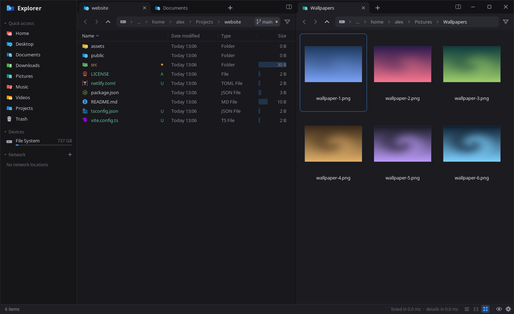

# File Explorer

**Just another file explorer.** Fast, keyboard-first, for Linux.

## Why
- **Never waits on the disk.** A folder with 200,000 files is listed, with sizes and dates, in under 0.1 s. Listing
  runs on worker threads, so the GPU-drawn UI never stalls.
- **Your keyboard is enough.** `Ctrl+P` jumps anywhere, typing finds a file, and every shortcut can be rebound.
- **Everything in one window.** Split panels with their own tabs, terminal tabs, previews, search inside files,
  a disk usage map, folder compare, and archives you browse like folders.
- **Looks the same on every desktop.** GNOME, KDE, Xfce, Hyprland, Sway... with themes, icon sets and its own title bar.

## Install
| Distro | Command | |
|---|---|---|
| Arch, CachyOS, Manjaro, EndeavourOS | `makepkg -si` in `packaging/arch` of a clone |  |
| Debian 13, Ubuntu 24.04+, Mint, Pop!_OS | `sudo apt install file-explorer` |  |
| Fedora, openSUSE | `sudo dnf install file-explorer` |  |
| Any distro | AppImage from [Releases](https://github.com/AlexMedela/file-explorer/releases) |  |
| From source | see [Building](docs/building.md) |  |

On Arch: `git clone https://github.com/AlexMedela/file-explorer && cd file-explorer/packaging/arch && makepkg -si`.
An AUR package follows once the AUR reopens account registration (paused because of spam).

Installing never replaces your current file manager or file picker: switch those on in **Options > Integration**
(default file manager, "Show in folder", file chooser for other apps). See [Integration](docs/integration.md).

## First steps
| Key | |
|---|---|
| `Ctrl+P` | Go to any folder or file |
| Type a name | Jump to it, `Ctrl+F` to filter or search below |
| `Ctrl+\` | Split the panel (each has its own tabs) |
| `Ctrl+T` / `Ctrl+W` | New tab / close tab |
| `Space` | Preview panel |
| `F4` | Terminal tab in this folder |
| `Ctrl+Shift+U` | Disk usage map |
| `Ctrl+,` | Options: themes, keys, views, title bar |

All keys: [docs/keys.md](docs/keys.md)

## Docs
[Keys](docs/keys.md) · [Settings](docs/settings.md) · [Integration](docs/integration.md) · [Building](docs/building.md) · [Architecture](docs/architecture.md)

## Licence
[MIT](LICENSE). Bundled icon sets and libraries keep their own licences, listed in [Building](docs/building.md#tools-and-self-tests).
